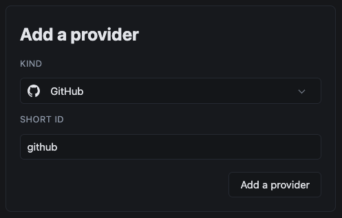
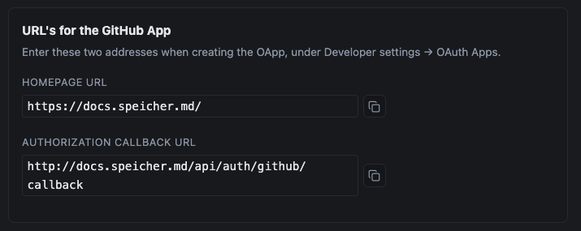
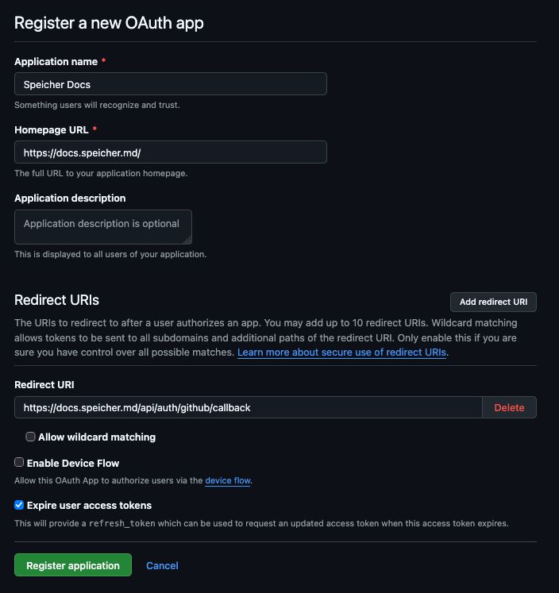
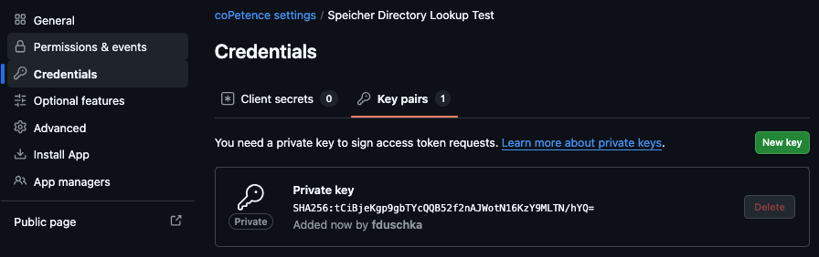
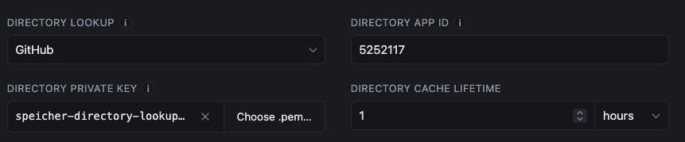

# GitHub as an Identity Provider

You can use GitHub as an identity provider. This lets users sign in using their GitHub account.

## 0. Before you start

GitHub offers several ways of authenticating users. Before you configure anything you should be aware of which setup suites your requirements best.
GitHub allows you to create OAuth apps and GitHub Apps, both can be created under a personal account or under an organization.

| Setup                                     | Use-Case                                                                                                                                                                |
| ----------------------------------------- | ----------------------------------------------------------------------------------------------------------------------------------------------------------------------- |
| **OAuth App** under **organization**      | <ins>Every GitHub user</ins> can login; you want to share documents with <ins>organization teams</ins> (permission can be assigned to teams and indidual users)         |
| **GitHub App** under **organization**     | Only <ins>Organization Members</ins> can login; you want to share documents with <ins>organization teams</ins> (permission can be assigned to teams and indidual users) |
| **OAuth App** under **personal account**  | <ins>Every GitHub user</ins> can login; you want to share documents with individual users (<ins>email address whitelist</ins>)                                          |
| **GitHub App** under **personal account** | <ins>Only you</ins> can login (kind of defeats the purpose but if you really want to, it works)                                                                         |

## 1. Create a new Speicher Identity Provider

In your Speicher Configuration go to Identity Providers and create a new one.
Select `GitHub` as the kind and give it a descriptive short id.

On the configuration page you will see two URL's that you will need for the next step.

## 2. Create GitHub OAuth app

In GitHub go to **Organization Settings → Developer Settings → OAuth Apps** and create a new OAuth app.

Give the OAuth app a descriptive Application Name and insert your Homepage URL and Redirect URI that you copied in the [step before](#1-create-a-new-speicher-identity-provider).

Then press `Register application`

Do this instead if you chose a **GitHub App** setup

Create the GitHub App under **Organization Settings → Developer Settings → GitHub Apps**, give it a descriptive name and paste in the homepage- and redirect-url. Now deactivate Webhooks and give it the `Organization Permission` **Members: Read only**.

After you created the app, copy the Client ID into the configuration and create a client secret under `Credentials`.

## 3. Link GitHub OAuth app to Speicher

You should now see the newly created OAuth app. Gnerate a new client secret and then copy the secret and the Client ID into the Speicher Identity Provider we created in the [first step](#1-create-a-new-speicher-identity-provider).

Then save your updated Speicher configuration. GitHub should now appear as a sign in option.

## 4. GitHub Directory Client (enhancement)

For advanced use cases we also support a GitHub directory client. This adds the following functionalities:

- Mid-session refresh: Without it a user keeps a team / group assignment until their session expires
- Group-size counts: See how many people are actually in a group
- Departed-principal detection: Drops grants for people who've left an organization

:::note
Directory clients are technically supported for private accounts as well but won't enable any of the mentioned functionalities.
This only makes sense on organization accounts!
:::

To configure the GitHub Directory Client select `GitHub` in the directory lookup dropdown.

Create a GitHub App (not OAuth App) under **Organization Settings → Developer Settings → GitHub Apps**.

:::note
It is highly recommended to create a seperate GitHub app instead of reusing the one you configured for authentication.
:::

Give the app a descriptive name, paste the Homepage URL from the [first step](#1-create-a-new-speicher-identity-provider), deactivate webhooks and assign the **Members: Read-only** permission (under Organization permissions).

Create the app and paste the App ID into the Configuration in Speicher. Now create a private key under **Credentials -> Key pairs**:

The private key .pem file should be downloaded automatically. Now you can upload that .pem file in your Speicher config.

