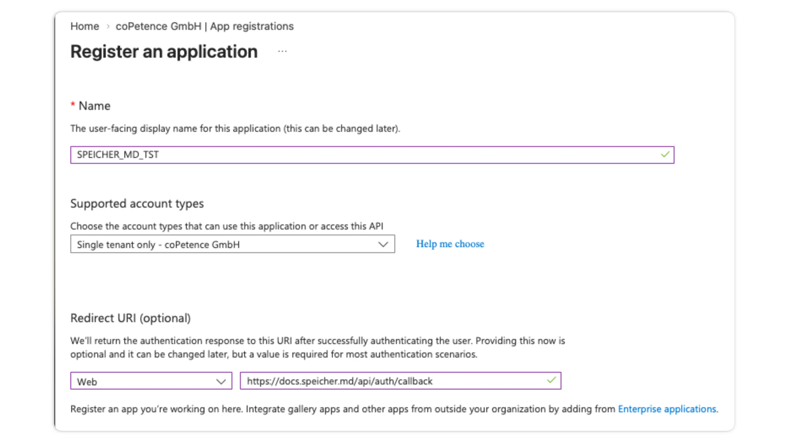
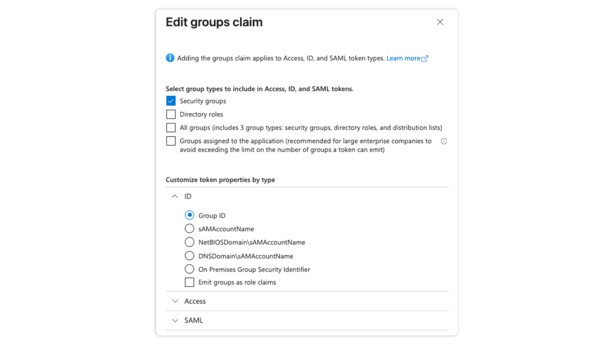
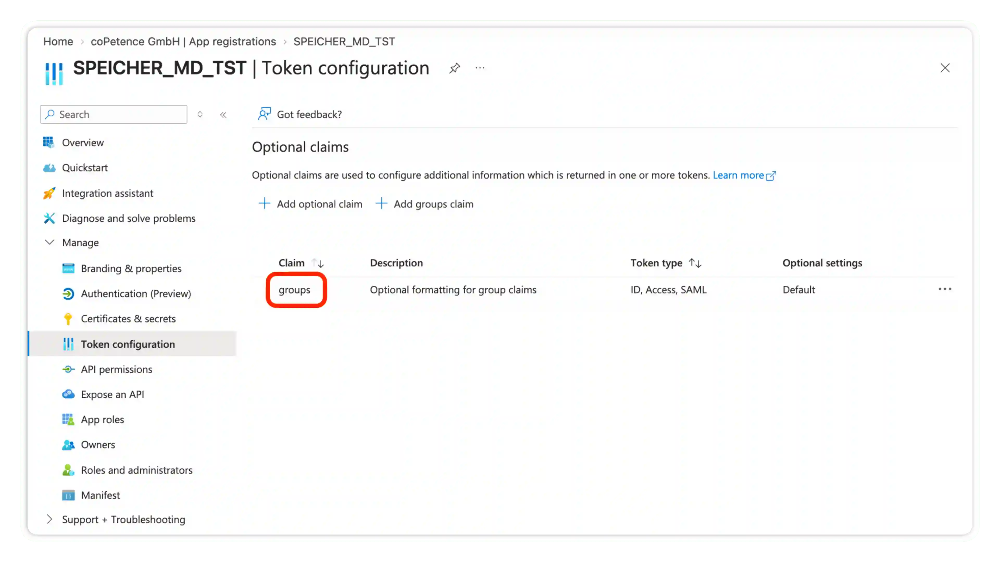
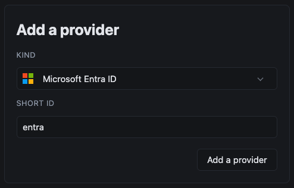
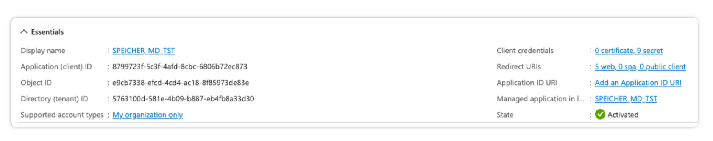
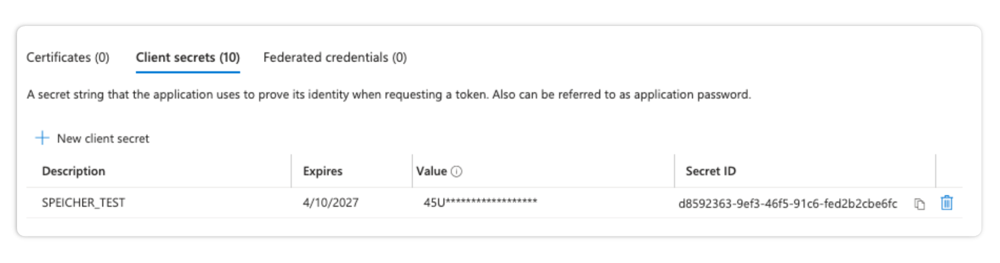
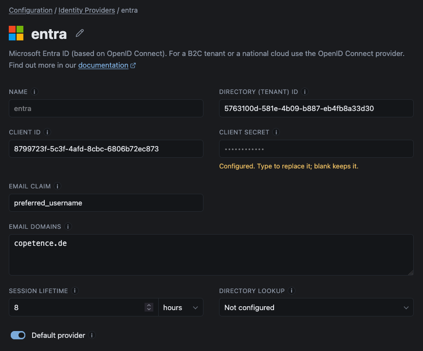
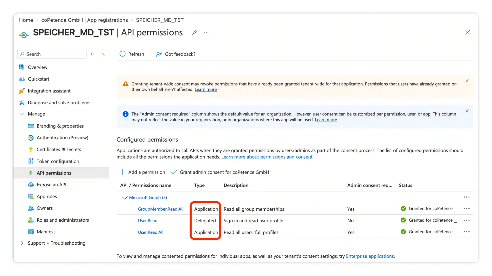

# Microsoft Entra ID

You can use Microsoft Entra ID as an identity provider. This lets users sign in using their Entra ID Accounts and you can use Entra ID Groups to provide access to documents in Seicher.

:::info
For a B2C tenant or a national cloud use the [OpenID Connect](../open-id) provider.
:::

## 1. Register the Entra ID Application

Open the Entra admin center and go to **Manage → App registrations → New Registration**.
Give the application a descriptive name and choose `Single tenant only`.

Add a `Web` redirect URI of:

```
https://<hostname>/api/auth/callback
```



## 2. Emit the groups claim

In the newly created app registration go to **Token configuration** and add the groups claim:
**Add groups claim → Security groupsƒ**, under **ID** select `Group ID`:



When you've added the claim the token configuration should look like this:



:::caution
A user in more than ~200 groups gets no groups claim at all (Entra replaces it with an overage indicator), 
and that reader resolves into no groups. We log an error, when this happens.
Emit **groups assigned to the application** instead of all security groups, and assign the relevant groups to the app registration.
:::

## 3. Configure the provider

In the Speicher Dashboard go to **Configuration → Identity Providers** and create a new Entra ID provider:



In the Entra Application Overview you should be able to see the `Application (client) ID` and `Directory (Tenant) ID`. Copy these values to the provider configuration form:



Now go to the **Entra App Registration → Certificates & secrets** and create a new `Client Secret`. Copy the Secret Value into the Client Secret Field in Speicher.



:::info
If your Entra ID configuration does not store the users email address in the `preferred_username` claim, update the Email Claim field according to your configuration.
:::

List the email domains that should use this identity provider in the `Email Domains` field. 
Example: if someone wants to sign in with a `@copetence.de` email they will just see identity providers that are configured for this email domain.



---

## Directory Lookup

Speicher can read your Entra ID directory through Microsoft Graph. This is an otpional feature which enhances the Entra ID functionality.s

### What a directory loopup adds

- **People who left the tenant loose their grants:** If a grant does not exist in the directory anymore (incl. disabled accounts) the grant gets dropped. This check happens at least daily or on every push to a repository.
- **Group reach:** Speicher can now resolve the number of users who are in a group. This can be helpful for access reviews.
- **Email Grants:** `email: alice@example.com` in a `.speicher.yaml` is resolved to an object id. If the email address is reassigned to a new user the old grant stays untouched.

### Register the directory application

We recommend to create a second app registration in Entra ID, with no redirect URI. Under API permissions, add Microsoft Graph application permissions: `User.Read.All` and `GroupMember.Read.All`. Then an administrator needs to grant admin consent. Create a client secret under Certificates & secrets.



:::info
The directory lookup is public-cloud only: it addresses `graph.microsoft.com` and `login.microsoftonline.com``
:::

