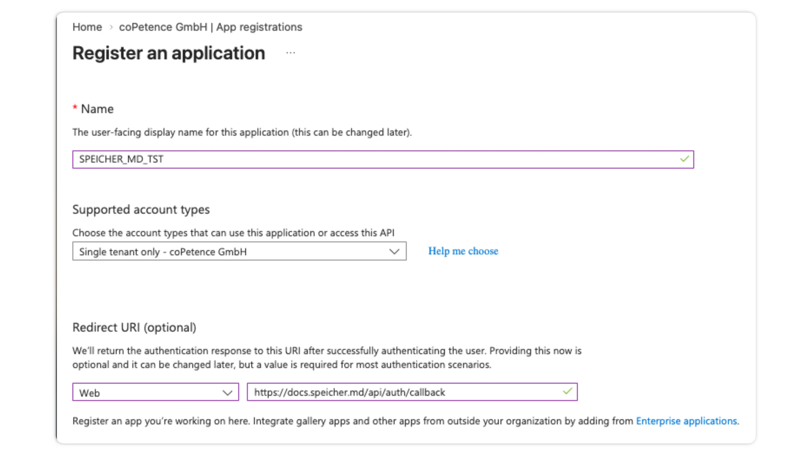
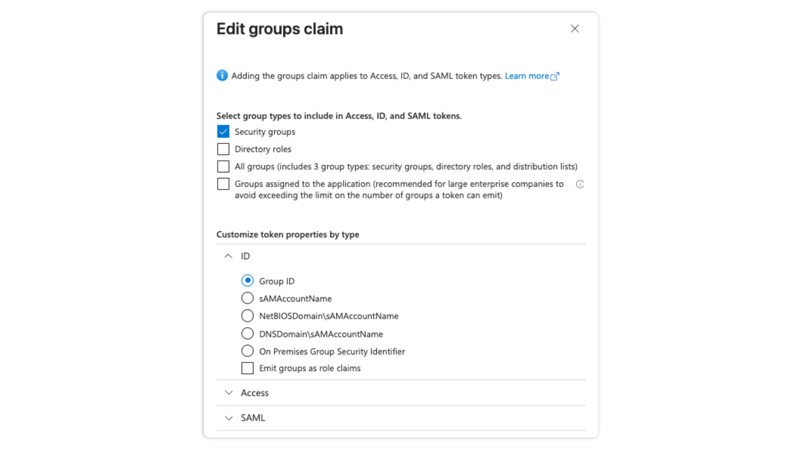
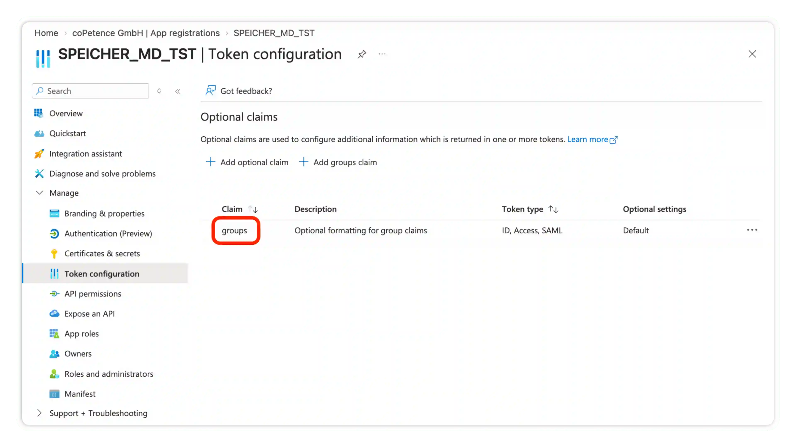
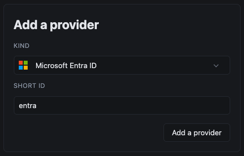
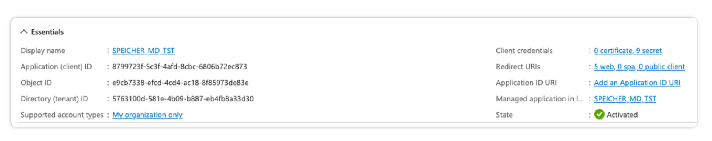
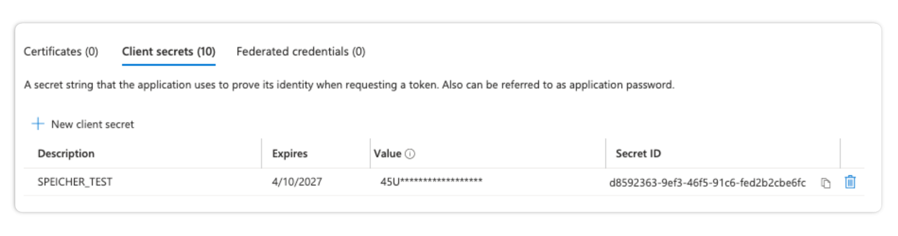
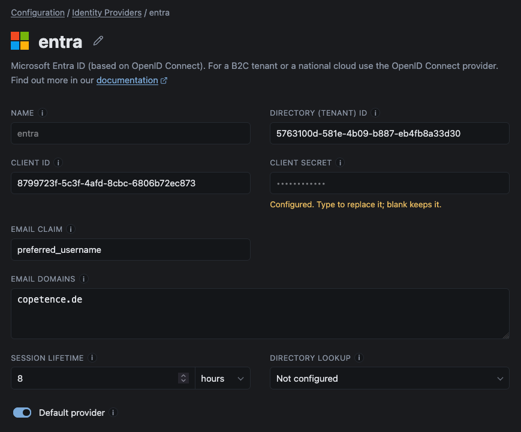
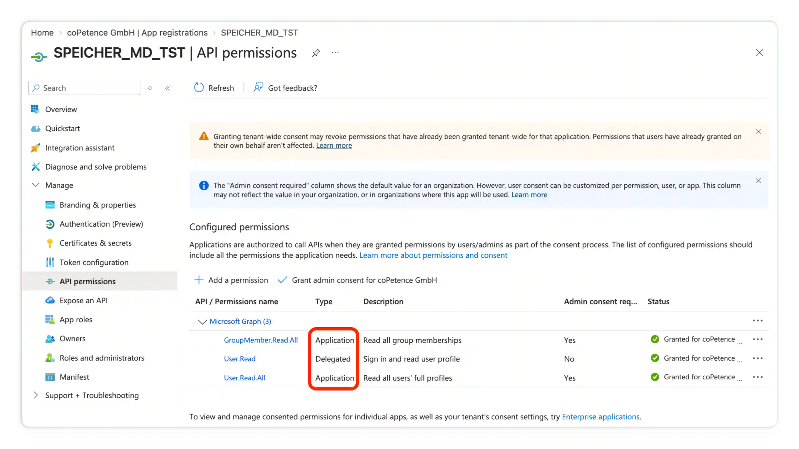

# Microsoft Entra ID

You can use Microsoft Entra ID as an identity provider. This lets users sign in using their Entra ID Accounts and you can use Entra ID Groups to provide access to documents in Seicher.

:::info
For a B2C tenant or a national cloud use the [OpenID Connect](../05-oidc/index.md) provider.
:::

## 1. Register the Entra ID Application

Open the Entra admin center and go to **Manage → App registrations → New Registration**.
Give the application a descriptive name and choose `Single tenant only`.

Add a `Web` redirect URI of:

```
https://<hostname>/api/auth/callback
```



## 2. Emit the groups claim

In the newly created app registration go to **Token configuration** and add the groups claim:
**Add groups claim → Security groups**, under **ID** select `Group ID`:



When you've added the claim the token configuration should look like this:



:::caution
A user in more than ~200 groups gets no groups claim at all (Entra replaces it with an overage indicator),
and that reader resolves into no groups. We log an error, when this happens.
To fix this emit **groups assigned to the application** instead of all security groups, and assign the relevant groups to the app registration.
:::

## 3. Configure the provider

In the Speicher Dashboard go to **Configuration → Identity Providers** and create a new Entra ID provider:



In the Entra Application Overview you should be able to see the `Application (client) ID` and `Directory (Tenant) ID`. Copy these values to the provider configuration form:



Now go to the **Entra App Registration → Certificates & secrets** and create a new `Client Secret`. Copy the Secret Value into the Client Secret Field in Speicher.



:::info
If your Entra ID configuration does not store the users email address in the `preferred_username` claim, update the Email Claim field according to your configuration.
:::

Under **Who should see this provider?**, choose **Only these domains** and list the email domains that should use this identity provider.
Example: if someone enters a `@copetence.de` address on the sign-in page, they are sent straight to the identity providers configured for this email domain.
Use it to show users only the sign-in options they are actually meant to use. If you leave it empty, the provider is available to all users.



---

## Directory Lookup

Speicher can read your Entra ID directory through Microsoft Graph. This is an optional feature which enhances the Entra ID functionalities.

### What a directory lookup adds

- **Stale grants:** Surfaces a warning if any `.speicher.yaml` grants access to a person, that does not exist anymore
- **Group reach:** Resolves the number of users who are in a group. This can be helpful for access reviews.

### Register the directory application

<Steps>
1. We recommend to create a second app registration in Entra ID. Choose `Single Tenant` and do not configure a redirect URI

2. Go to **API permissions** and add Microsoft Graph application permissions: `User.Read.All` and `GroupMember.Read.All`

3. Grant administrator consent for the newly added API permissions

4. Create a new client secret under **Certificates & secrets**

</Steps>



:::info
The directory lookup feature is availiable on public Azure cloud only. The directory client is not compatible with US Government or China Government Azure cloud deployments.
:::
