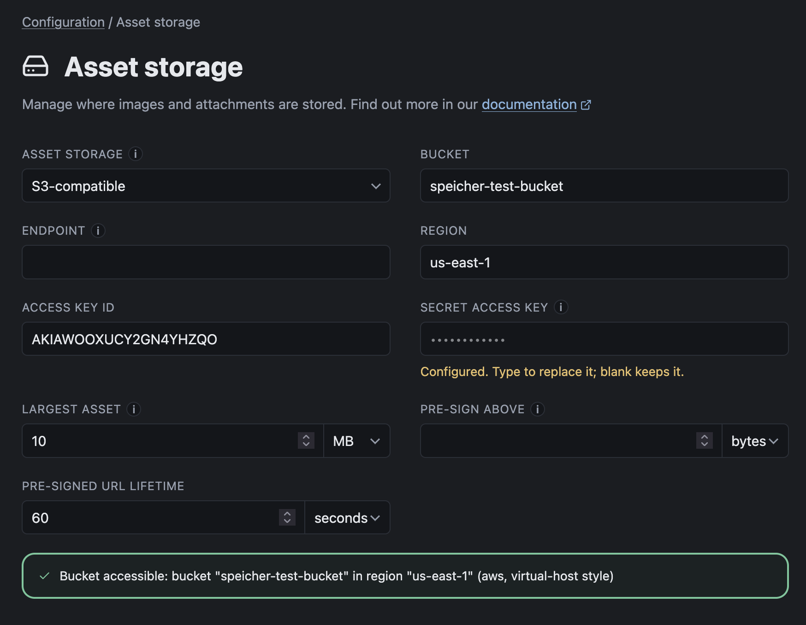

# Asset Storage

If your repositories contain images or assets we store a copy of them in your configured asset storage.
The files stored in the asset storage are served using the same access permissions as the markdown files in your repositories.

Availiable asset storage drivers:

- Filesystem volume
- S3 compatible storage
- Azure Blob Storage

:::caution[Hot-Swapping Asset Storage]
When you already have a productive asset storage configured, switching asset storage means all assets need to be reingested.
You will be prompted to restart the instance. Afterwards a [full rebuild](TODO:Insert Full Rebuild Docs Link) is required.
:::

## Filesystem volume

Assets are written to a directory on disk.

| Field                                                       | Notes                                                     |
| ----------------------------------------------------------- | --------------------------------------------------------- |
| **Volume path** <Badge text="required" variant="caution" /> | Default `./var/assets`. Must be writable by the instance. |

Use a single replica, or a volume every replica can write (RWX).

# S3 compatible storage

You can use any S3 compatible storage provider like AWS, Hetzner, MinIO, etc.

| Field                                                             | Notes                                                            |
| ----------------------------------------------------------------- | ---------------------------------------------------------------- |
| **Bucket** <Badge text="required" variant="caution" />            | Make sure the bucket exists. Speicher does not create it for you |
| **Region** <Badge text="required" variant="caution" />            | For example `eu-central-1`                                       |
| **Endpoint** <Badge text="optional" variant="note" />             | Leave empty for AWS                                              |
| **Access key id** <Badge text="required" variant="caution" />     |                                                                  |
| **Secret access key** <Badge text="required" variant="caution" /> |                                                                  |

The credentials need `GetObject`, `PutObject`, `DeleteObject` and `ListBucket` on the bucket.

:::caution[Reads fail with `NoSuchKey`]
The bucket only holds assets that were ingested while it was configured. Run a [full rebuild](TODO:Insert Full Rebuild Docs Link) after switching.
:::

## Azure Blob Storage

| Field                                                               | Notes                                                               |
| ------------------------------------------------------------------- | ------------------------------------------------------------------- |
| **Storage account** <Badge text="required" variant="caution" />     | Account name (not the URL)                                          |
| **Container** <Badge text="required" variant="caution" />           | Make sure the container exists. Speicher does not create it for you |
| **How to authenticate** <Badge text="required" variant="caution" /> | See below. Default `Account key`                                    |
| **Blob endpoint** <Badge text="optional" variant="note" />          | Only for a sovereign cloud or a local emulator                      |

### How to authenticate

| Option                                                  | Needs                                                         | Use-Case                                                   |
| ------------------------------------------------------- | ------------------------------------------------------------- | ---------------------------------------------------------- |
| **Account key** <Badge text="default" variant="info" /> | `Account key`                                                 | The default. A shared secret granting the whole account.   |
| **Connection string**                                   | `Connection string`                                           | Carries its own endpoint, so **Blob endpoint** is ignored. |
| **Managed identity (host)**                             | `Identity client id` (optional)                               | The identity of a VM, Container App or App Service.        |
| **Workload identity (AKS)**                             | `Identity client id`, `Directory (tenant) id` (both optional) | The federated token an AKS pod is handed.                  |
| **SDK default chain (development)**                     | —                                                             | Development only. Not offered in production.               |

Managed identity and workload identity are different mechanisms. The wrong one fails as a timeout, not as a refusal.

The identity needs the **Storage Blob Data Contributor** role on the container.

## Limits and delivery

| Field                       | Default | Notes                                                                                                                                        |
| --------------------------- | ------- | -------------------------------------------------------------------------------------------------------------------------------------------- |
| **Largest asset**           | 10 MB   | Anything larger is reported to the author as a finding, and not stored                                                                       |
| **Pre-sign above**          | 0       | `0` serves every asset through the instance. Above this size it issues a pre-signed URL so that the asset is served directly from the source |
| **Pre-signed URL lifetime** | 60s     | How long a pre-signed URL stays valid                                                                                                        |

Pre-signing is only offered for S3 and Azure Blob Storage, and is never used for images.

Pre-signing needs an account key, so it is unavailable under managed identity, workload identity and the SDK default chain.
