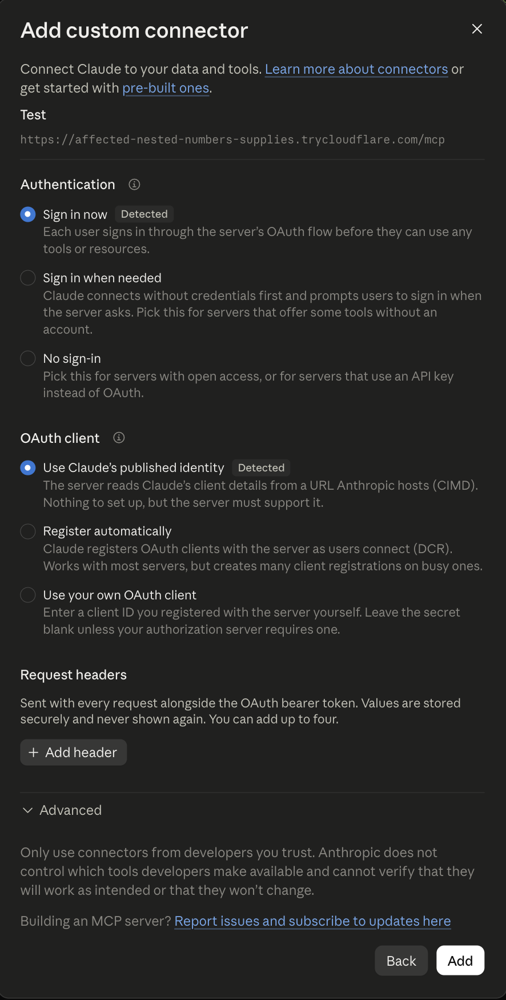
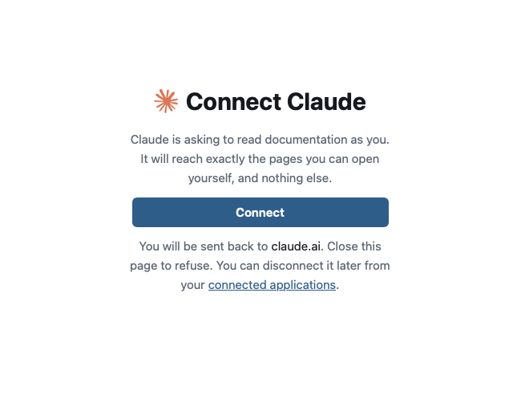

# Claude

You can connect Speicher to Claude as a custom connector. Claude can then search and read your documentation in any chat, with exactly the access you have yourself.

Your Speicher administrator must have set up the instance for AI assistants first. See [Before you start](./#before-you-start).

## 1. Add the connector

In Claude, open **Settings → Connectors** and choose **Add custom connector**.

- **Name:** what the connector is called in Claude, for example `Company Docs`.
- **URL:** your Speicher address followed by `/mcp`:

```
https://<hostname>/mcp
```

Click **Continue**.

## 2. Choose how to sign in

Claude checks the server and offers three options under **Authentication**. Choose **Sign in now**.

:::caution
If Claude marks **No sign-in** as detected, check that you entered `/mcp` and not `/mcp/public`. Otherwise the instance is not set up for AI assistants yet: `SPEICHER_PUBLIC_URL` is missing or points to a different address. Ask your administrator before you continue. With **No sign-in**, Claude only sees public pages.
:::

Click **Add**.



## 3. Sign in and connect

Claude opens Speicher in a new window:

1. Sign in to Speicher as usual.
2. Speicher shows **Connect Claude**. Click **Connect**.
3. You are sent back to Claude. The connector is now connected.



## 4. Use it in a chat

Ask Claude about your documentation, for example:

- _"Search our docs for how to request a new laptop."_
- _"Read the onboarding page in the handbook and summarise the first week."_
- _"Which repositories in our docs talk about deployments?"_

Claude decides on its own when to search, read or list pages. It shows you which tools it used.

## Disconnecting

You can end the connection from either side:

- **In Speicher:** open **Connected applications** (`/-/connections`) and click **Disconnect** next to Claude.
- **In Claude:** remove the connector under **Settings → Connectors**.

## Troubleshooting

**"Claude connects from Anthropic's servers, so it can't reach a local address like this one."**
Claude needs a public HTTPS address. A `localhost` or intranet address does not work.

**Claude asks you to connect again every day.**
Your identity provider has no directory lookup, so connections end after the session lifetime. See [How long a connection lasts](./#how-long-a-connection-lasts).

**Claude cannot find a page you can open in the browser.**
Make sure you signed in with the same account in step 3. Claude only sees what that account can see.
