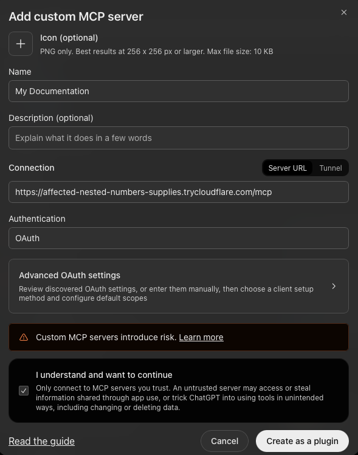
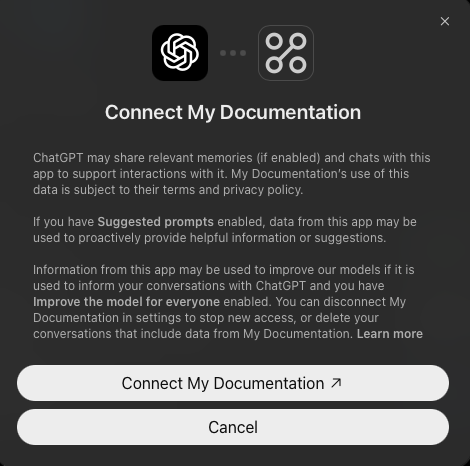
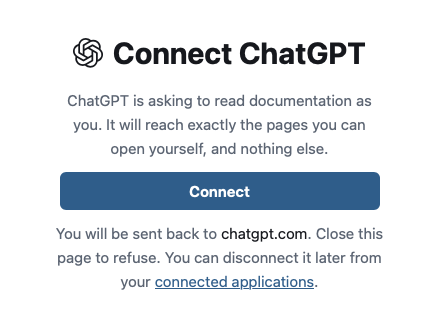

# ChatGPT

You can connect Speicher to ChatGPT as a custom MCP server. ChatGPT can then search and read your documentation in a chat, with exactly the access you have yourself.

:::info[Which ChatGPT plans can connect]
Custom MCP servers are available on ChatGPT **Business**, **Enterprise** and **Edu**, in ChatGPT on the web. **Pro** accounts can connect servers that only read, which is all Speicher does.

On Business, only workspace admins and owners can add a custom MCP server. On Enterprise and Edu, admins decide who may add one. If you do not see the option described below, ask your ChatGPT workspace admin.
:::

## 1. Add the MCP server

In ChatGPT on the web, open **Plugins**, select the plus button and choose **Add custom MCP server**.

- **Name:** what the server is called in ChatGPT, for example `Company Docs`.
- **Description:** optional, but worth filling in. ChatGPT reads it when deciding whether to use the server, for example `Our internal documentation: handbook, specifications and guides.`
- **Connection:** keep **Server URL** selected and enter your Speicher address followed by `/mcp`:

```
https://<hostname>/mcp
```

- **Authentication:** leave it on **OAuth**. You do not need the **Advanced OAuth settings**.

Tick **I understand and want to continue** and click **Create as a plugin**.



## 2. Sign in and connect

ChatGPT first asks you to confirm the connection. Click the **Connect** button in that dialog.



ChatGPT then opens Speicher to authorize the connection:

1. Sign in to Speicher as usual.
2. Speicher shows **Connect ChatGPT**. Click **Connect**.
3. You are sent back to ChatGPT. The server is now connected.

To refuse, close the window instead of clicking **Connect**.



## 3. Use it in a chat

Type **@** in the message box and select the server, then ask about your documentation, for example:

- _"Search our docs for how to request a new laptop."_
- _"Read the onboarding page in the handbook and summarise the first week."_
- _"Which repositories in our docs talk about deployments?"_

## Disconnecting

You can end the connection from either side:

- **In Speicher:** open **Connected applications** (`/-/connections`) and click **Disconnect** next to ChatGPT. ChatGPT asks you to connect again the next time it needs the documentation.
- **In ChatGPT:** disconnect the server in ChatGPT's settings.

## Troubleshooting

**The option to add a custom MCP server is missing.**
Your ChatGPT plan or workspace does not allow it. See the note on plans at the top of this page, or ask your ChatGPT workspace admin.

**ChatGPT asks you to connect again every day.**
Your identity provider has no directory lookup, so connections end after the session lifetime. See [How long a connection lasts](./#how-long-a-connection-lasts).

**ChatGPT cannot find a page you can open in the browser.**
Make sure you signed in with the same account in step 2. ChatGPT only sees what that account can see.
