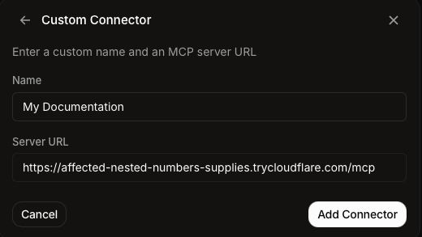
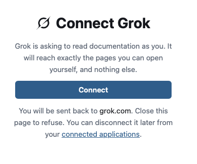

# Grok

You can connect Speicher to Grok as a custom connector. Grok can then search and read your documentation in a chat, with exactly the access you have yourself. Custom connectors work with a standard Grok account.

:::caution[Not in the Grok mobile app]
The Grok mobile app does not support MCP connectors. Add and use the Speicher connector in Grok on the web instead.
:::

:::info[Grok Business and Enterprise]
On Grok Business and Enterprise, a team admin adds the connector for the whole team first: in the [xAI console](https://console.x.ai), select the team, go to **Grok Business → Connectors**, click **+ Add Connector**, choose **Other** and enter the `/mcp` address below. Each team member then connects their own account as described in step 2.
:::

## 1. Add the connector

In Grok, open **Plugins** in the sidebar and stay on the **Connectors** tab, or go straight to [grok.com/connectors](https://grok.com/connectors). Click **New Connector** and choose **Custom** (_Add your own custom connector_) at the top of the list.

- **Name:** what the connector is called in Grok, for example `Company Docs`.
- **Server URL:** your Speicher address followed by `/mcp` or `/mcp/public`. For example:

```
https://<hostname>/mcp
```

```
https://<hostname>/mcp/public
```

Use `/mcp` if you want Grok to see pages that require authentication, or `/mcp/public` if you want it to see only public pages.

Click **Add Connector**.



## 2. Sign in and connect

Grok opens Speicher to authorize the connection:

1. Sign in to Speicher as usual.
2. Speicher shows **Connect Grok**. Click **Connect**.
3. You are sent back to Grok (`grok.com`). The connector is now connected.



## 3. Use it in a chat

Grok makes Speicher's tools available in your conversations. Ask about your documentation, for example:

- _"Search our docs for how to request a new laptop."_
- _"Read the onboarding page in the handbook and summarise the first week."_
- _"Which repositories in our docs talk about deployments?"_

## Disconnecting

To end the connection from Speicher, open **Connected applications** (`/-/connections`) and click **Disconnect** next to Grok. Your connectors in Grok are listed on [grok.com/connectors](https://grok.com/connectors).

## Troubleshooting

**Grok rejects the server URL.**
Grok only connects to servers reachable over the public internet. A `localhost` or intranet address does not work.

**Grok asks you to connect again every day.**
Your identity provider has no directory lookup, so connections end after the session lifetime. See [How long a connection lasts](index.mdx#how-long-does-a-connection-last).

**Grok cannot find a page you can open in the browser.**
Make sure you signed in with the same account in step 2. Grok only sees what that account can see.
