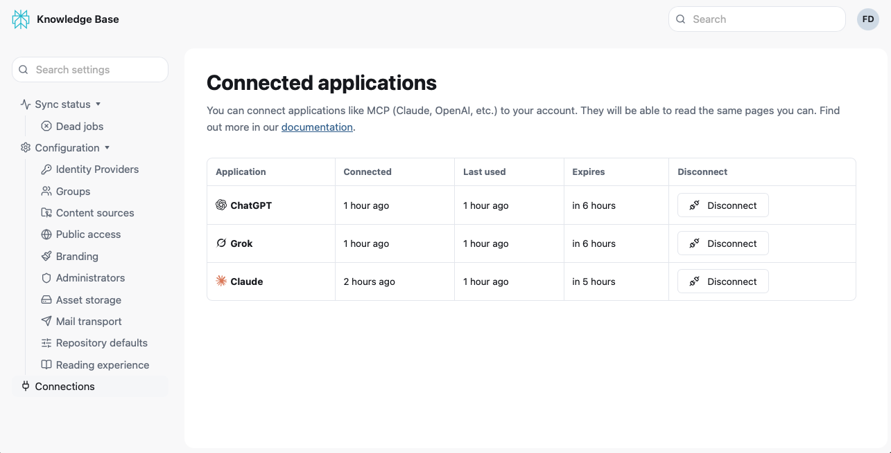

# AI Assistants

Speicher has a built-in [MCP](https://modelcontextprotocol.io) server. AI assistants that support remote MCP connectors, like Claude, ChatGPT or Grok can search and read your documentation while you chat with them.

Speicher enforces exactly the same access control for assistants as it does for people: an assistant can only read what the person who connected it can read. If a person has no account, or is not signed in, the assistant can only read public pages.

**There are two available endpoints for connecting an assistant:**

1. The main endpoint for connecting an assistant, which requires signing in:

```
https://<hostname>/mcp
```

2. A second endpoint for connecting an assistant to public documentation, which does not require signing in:

```
https://<hostname>/mcp/public
```

## Connecting an assistant

Each person connects their own assistant:

<Steps>
1. Add Speicher as a connector in the assistant, using the `/mcp` address above.

2. The assistant opens Speicher's sign-in page. Sign in as usual.

3. Speicher shows a **Connect** page. Click **Connect**.

4. You return to the assistant, which can now use the documentation.

</Steps>

Step-by-step guides for some assistant:

- [Claude / Anthropic](02-claude.md)
- [ChatGPT / OpenAI](03-chatgpt.md)
- [Grok / xAI](04-grok.md)

## How long does a connection last?

How long a connection lasts depends on whether the identity provider has a [directory lookup](../02-configuration/01-identity-providers/02-entra-id/index.mdx#directory-lookup) configured.

**With a directory lookup:**

- The connection gets refreshed automatically and only requires a manual reconnect if the connection has not been used for **30 days**.
- If someone is removed from a group, the assistant loses access to that group's pages within an hour.
- If someone's account is deleted or disabled in the directory, the connection is ended at the next renewal (based on your configured session lieftime).
- You can change the 30 days with **Connection idle lifetime** on the identity provider.

**Without a directory lookup:**

- A connection ends with the provider's **session lifetime** (8 hours by default).
- After that the assistant asks the person to sign in again.

## Managing connections

Everyone can see their own connections under **Connected applications** (`/-/connections`) in Speicher. The list shows each assistant, when it was connected and last used, and when the connection will end.

**Disconnect** ends a connection. The assistant loses access with its next request.



## Troubleshooting

**The assistant says no sign-in is needed, or only shows public pages.**
Check that the connector uses the `/mcp` address, not `/mcp/public`. If it does, `SPEICHER_PUBLIC_URL` is not set, or is set to a different address than the one you entered in the assistant. Set it to the public address and restart Speicher.

**The assistant cannot reach the server.**
The instance must be reachable over HTTPS from the internet.

**The assistant has to be reconnected every day.**
The identity provider has no directory lookup. See [How long a connection lasts](#how-long-does-a-connection-last).

**The assistant cannot find a page you can see.**
Check that you connected the assistant with the same account you use in the browser.

**Can I also connect local MCP servers?**
We have this feature on our roadmap, but it is not implemented yet.

**Does Speicher support Pre-registered MCP Clients or DCR?**
Not yet. We have this feature on our roadmap, but it is not implemented yet.
