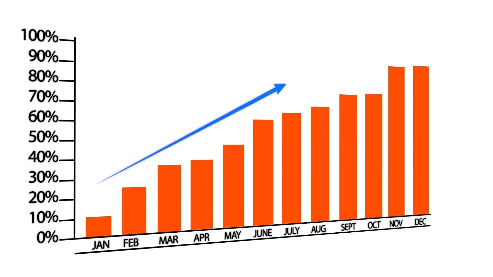

# Where things live

This page is readable by the whole repo-root grant — engineering, commercial,
client-northwind and dave. It deliberately links to pages that are readable by *fewer*
people than can read this one, which is the case worth being explicit about.

Speicher renders one copy of a page for every reader. The link text below is
**content**, written by an author who chose to put it on a page with this audience,
so everyone reading this sees it. What the link does *not* do is grant anything:
following it runs the same authorization check as typing the URL, so it returns 404
for anyone the target does not admit — the same 404 they would get for a page that
does not exist.

Ingest reports each of these as a warning against this file, so whoever wrote the
link finds out at pull-request time rather than from a colleague hitting a 404.

## Links narrower than this page

- [Pricing](commercial/pricing.md) — `commercial` only. Everyone else gets a 404.
- [The commercial section](commercial/index.md) — same audience.
- [Northwind handover](northwind/handover.md) — `client-northwind` only.
- [Contracts](commercial/legal/contracts.md) — nobody at all: that folder's `access`
  intersects to the empty set, so this link 404s for every principal including the
  person who wrote it.

## A link nobody loses on

- [Setup](02-setup.md) — same audience as this page, so it is not flagged.

## An image from a narrower folder

An asset inherits the access of the directory it belongs to, so this renders as a
broken image for anyone outside `commercial` — the `` is in the HTML, and the
request for its bytes 404s:

