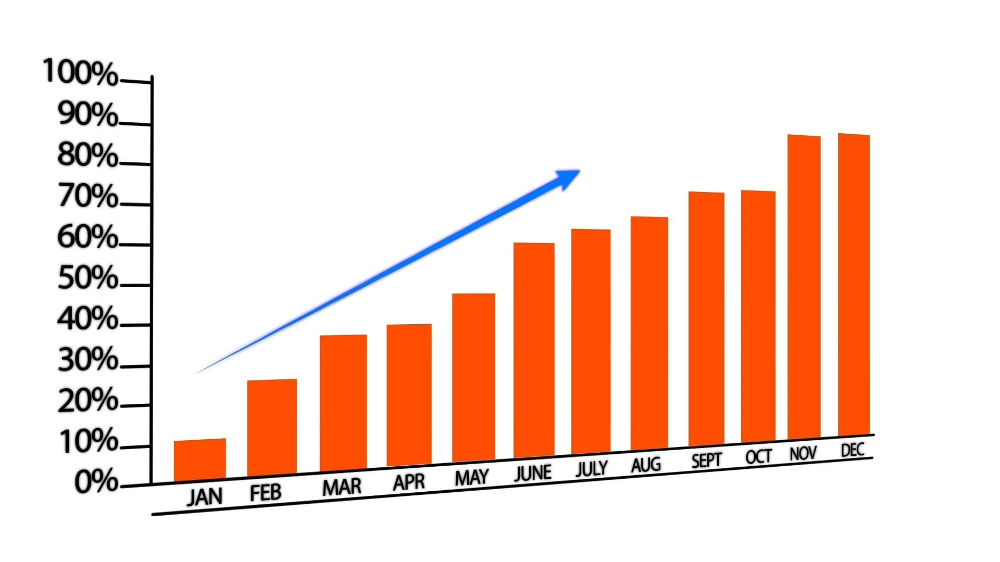

# Pricing

Restricted to `commercial`. The chart below is an asset in this subtree, so it
inherits this folder's access: a 404 for anyone who cannot read this page.



## Rate card

| Role              | Band | Day rate | Notes                       |
| ----------------- | ---: | -------: | --------------------------- |
| Principal         |    1 |    1,850 | Includes architecture work  |
| Senior engineer   |    2 |    1,450 |                             |
| Engineer          |    3 |    1,150 | Blended for teams of three+ |
| Analyst           |    4 |      950 | Half-day minimum            |

> Rates are indicative and expire with the quarter they were issued in.

## Factors

1. Engagement length
   - Under four weeks: no discount
   - Four to twelve weeks: 5%
   - Beyond twelve weeks: negotiated
2. On-site requirement
3. Notice period

```json
{ "band": 2, "day_rate": 1450, "currency": "EUR" }
```

Assets referenced from content are ingested even though `sync.include` is
`**/*.md` and does not match a PNG.

A link back up the tree, which has to resolve relative to *this* file's directory:
[the introduction](../01-introduction.md). That target is readable by *more* people
than this page, which is fine and is not flagged — narrowing downward is the only
direction that surprises anyone.
